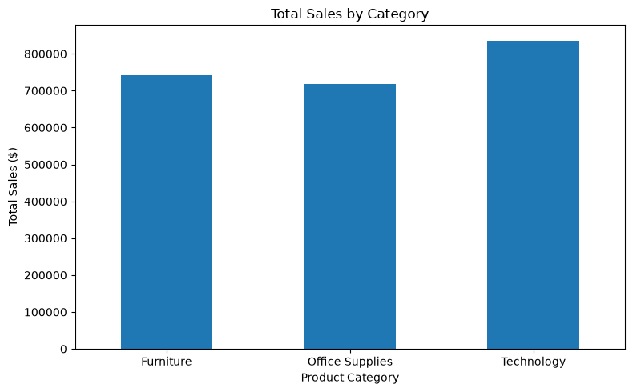
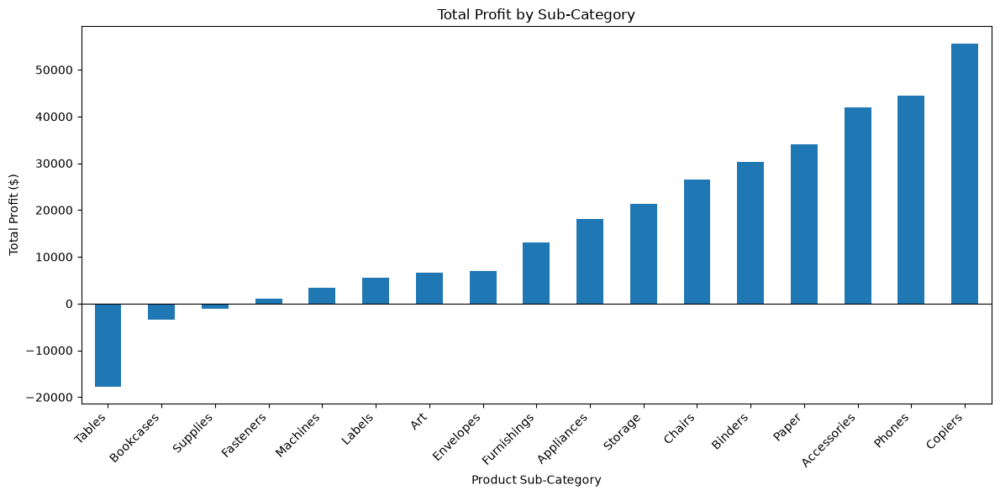
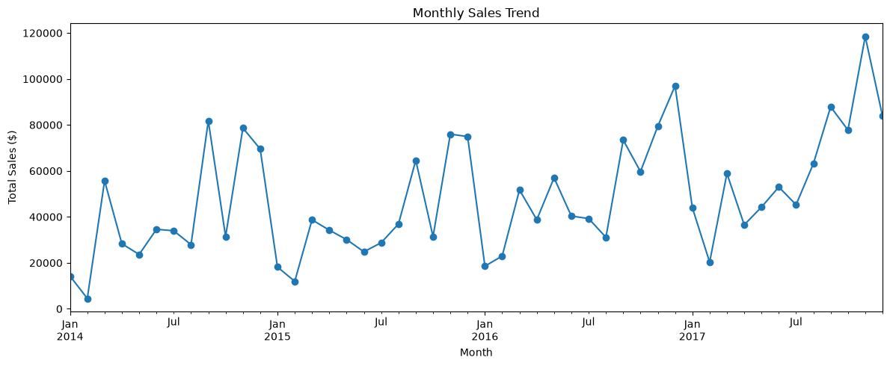
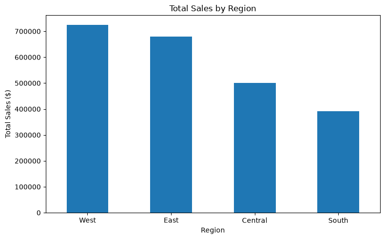
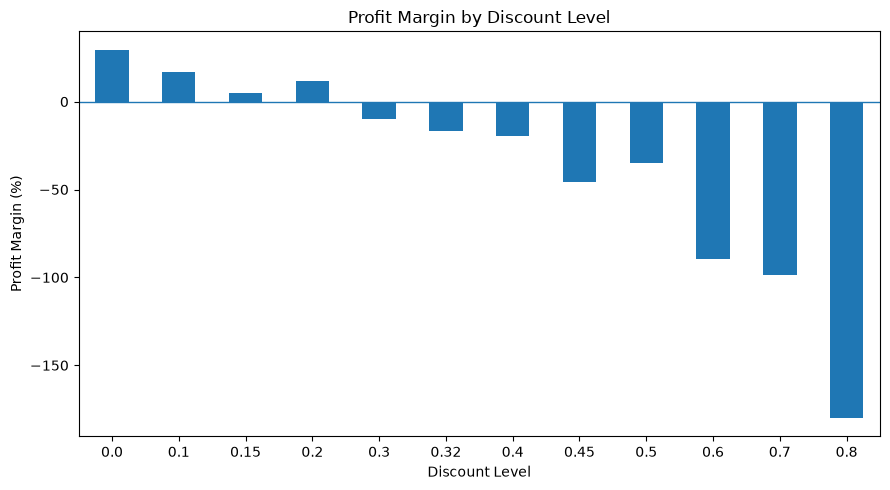
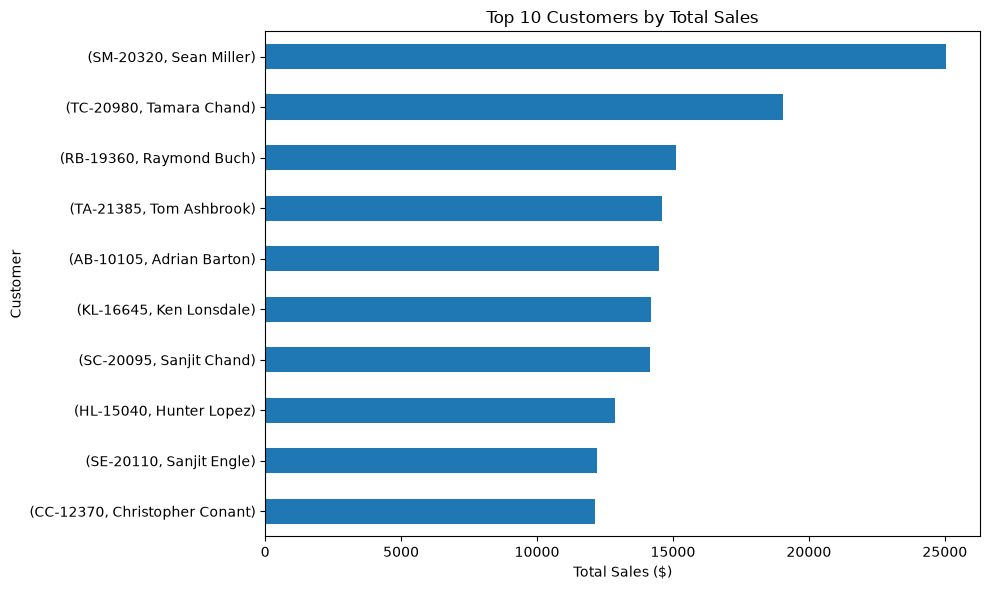

E-commerce Sales & Customer Analytics

Project Overview

This project analyses e-commerce sales data to understand sales performance, product profitability, customer purchasing behaviour and regional sales patterns.

Using Python and SQL, I explored sales trends, compared product categories, investigated the relationship between discount levels and profitability, and identified customers with high sales revenue.

The goal is to turn raw sales data into useful business insights and recommendations.

Dataset Overview

The dataset contains 9,994 records and 21 columns, including information about:

* Customer orders and order dates
* Product categories and sub-categories
* Sales revenue and quantities sold
* Discounts and profit
* Customer information and geographical regions

The main variables used in the analysis were Sales, Profit, Quantity, Discount and Order Date.

Tools and Technologies

* Python — Data analysis and calculations
* Pandas — Data cleaning, manipulation and aggregation
* Matplotlib — Data visualisation
* SQL — Querying and summarising sales data
* SQLite — Database operations, if used in the completed project
* Jupyter Notebook — Documenting the analysis and displaying results

Business Questions

This project investigates six business questions:

1. Which product category generates the highest sales?
2. Which product sub-categories generate the most and least profit?
3. How does sales performance change over time?
4. Which regions contribute the most to sales?
5. How are different discount levels associated with profitability?
6. Which customers generate the highest sales, and do they also generate high profit?

Key Findings

1. Technology Generated the Highest Sales

Technology generated approximately $836,154.03 in sales, followed by Furniture at $741,999.80 and Office Supplies at $719,047.03.

2. Furniture Had a Low Profit Margin

Furniture generated approximately $741,999.80 in sales but only $18,451.27 in profit, resulting in a profit margin of approximately 2.49%.

In comparison, Technology and Office Supplies had profit margins of approximately 17.40% and 17.04%, respectively.

3. Sales Varied Across Months

November 2017 recorded the highest monthly sales at approximately $118,447.82, while February 2014 recorded the lowest at approximately $4,519.89.

These historical patterns could be investigated further to understand seasonal demand.

4. Regional Sales Performance Differed

The West region generated the highest sales at approximately $725,457.82, while the South region generated the lowest at approximately $391,721.90.

5. Profitability Varied by Discount Level

The 0% discount level recorded the highest profit margin at approximately 29.51%. The 80% discount level recorded the lowest profit margin at approximately -180.03%.

This suggests that high discount levels were associated with weaker profitability in this dataset. However, the analysis does not establish that discounts alone caused the lower profit margins.

6. High Sales Did Not Always Mean High Profit

Sean Miller recorded the highest customer-level sales at approximately $25,043.05, but the associated total profit was approximately -$1,980.74.

This demonstrates why customer performance should be evaluated using both sales and profit.

Visualisations

Sales by Category

Profitability by Sub-Category

Monthly Sales Trend

Sales by Region

Discount Analysis

Customer Analysis

Business Recommendations

Based on the analysis, the business could:

* Investigate the factors contributing to Furniture’s low profit margin.
* Review pricing, discount practices and product costs across sub-categories.
* Evaluate whether high discount levels generate sufficient profit.
* Compare customer sales and profitability to identify valuable customer relationships.
* Investigate monthly and regional sales patterns to support inventory and promotional planning.

These recommendations require further investigation before specific business actions are implemented.

Project Structure
Ecommerce-Sales-Customer-Analytics/
├── data/
├── notebook/
│   └── sales_analysis.ipynb
├── sql/
├── images/
├── reports/
│   └── project_findings.md
└── README.md

How to Run the Project

1. Download or clone this repository.
2. Install the required Python packages.
3. Open notebook/sales_analysis.ipynb in VS Code or Jupyter Notebook.
4. Ensure the dataset is available at the file path used in the notebook.
5. Run the notebook cells in order to reproduce the analysis.
6. Review the SQL queries in the sql/ folder.

Limitations

* The analysis describes historical sales performance and does not guarantee future results.
* The dataset may not include all operating costs or external factors affecting profitability.
* Differences in profitability across discount levels do not prove that discounts alone caused those differences.
* Customer sales and profit totals do not fully explain customer loyalty or future purchasing behaviour.
* Data quality checks cannot guarantee that every record is accurate.

Dataset Source

Document the original dataset source and its usage licence here before publishing the project.